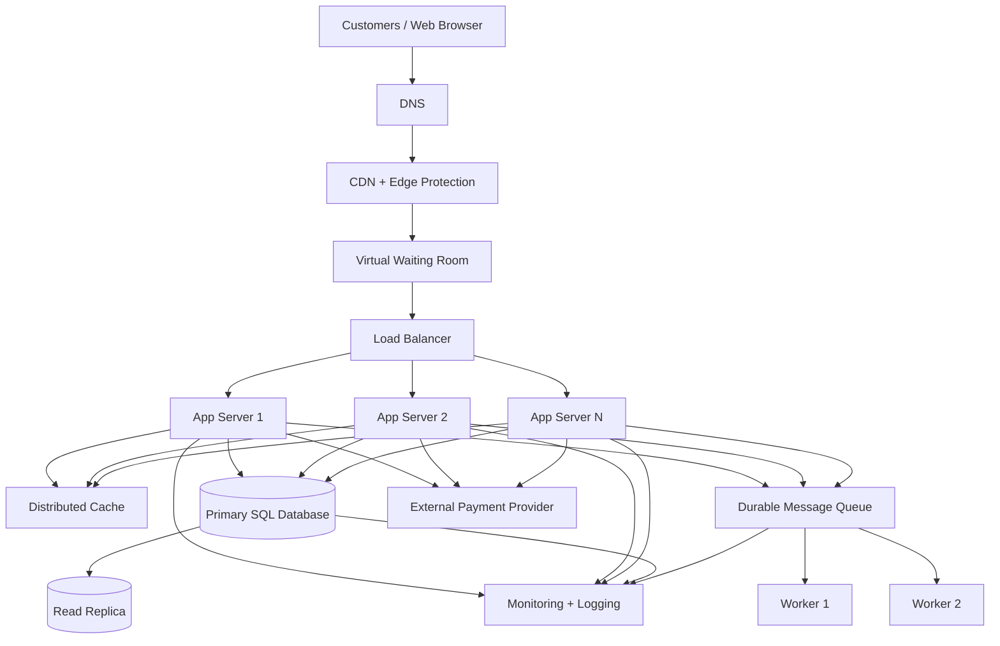

# TicketHub System Design

## 1. Requirements

TicketHub is a website that allows customers to discover concerts and events, view available seats, temporarily hold seats, purchase tickets, and view their purchased tickets.

The system must support normal daily traffic while also handling very large traffic spikes when popular concerts go on sale.

### 1.1 Functional Requirements

TicketHub must allow users to:

1. Register and log into their accounts.
2. Browse upcoming concerts and events.
3. Search and filter events by name, date, location, or category.
4. View event details, including venue, date, time, price, and available seats.
5. View a seat map and the current availability of seats.
6. Temporarily hold available seats during checkout.
7. Pay for held seats.
8. Receive confirmation after a successful purchase.
9. View their purchased tickets.
10. Prevent a seat from being sold to more than one customer.
11. Release held seats when the hold expires or payment fails.
12. Allow event administrators to create and manage events and seats.

### 1.2 Non-Functional Requirements

#### Speed

Normal browsing requests should normally return within approximately 200–300 ms when data is cached or readily available.

Seat availability should be displayed quickly enough that customers can make purchasing decisions without waiting unnecessarily.

During a major sale, the system should remain responsive instead of allowing the database to become overwhelmed by uncontrolled requests.

#### Correctness

TicketHub must guarantee that a successfully purchased seat belongs to only one order.

The system must prevent:

- Two customers purchasing the same seat.
- Payment being confirmed for an unavailable seat.
- Expired holds being treated as permanent purchases.
- Duplicate processing of the same payment request.

Database transactions, row-level locking, unique constraints, and idempotency controls will be used for critical purchase operations.

#### Fairness

The system should treat customers fairly during extremely popular sales.

Because 200,000 people may attempt to purchase only 20,000 seats, TicketHub should use a virtual waiting room or queue.

Customers arriving during the sale should receive a queue position or token rather than all being allowed to compete directly for database connections.

The queue protects the system while giving customers a predictable and fair purchasing process.

#### Availability

The system should continue serving event browsing even when ticket purchasing traffic becomes extremely high.

Multiple application servers, redundant infrastructure, caching, and database replication reduce the impact of individual component failures.

#### Scalability

Application servers should be horizontally scalable so additional instances can be added during large events.

Read-heavy traffic should be separated from critical ticket inventory operations.

#### Security

The system should use:

- HTTPS.
- Secure password hashing.
- Authentication and authorization.
- Server-side input validation.
- Parameterized database queries.
- Payment-provider security controls.
- Rate limiting.
- Audit logging.
- Secure handling of payment information.

TicketHub should not store raw card numbers unless it has the appropriate security and compliance controls.

---

# 2. Traffic and Capacity Estimates

The provided requirements are:

- 2,000,000 registered users.
- 50,000 visitors on a normal day.
- Each visitor views 10 pages.
- 5,000 tickets sold on a normal day.
- During a popular concert sale, 200,000 people attempt to buy 20,000 seats within 10 minutes.

These estimates are planning assumptions. Production capacity should be validated using load testing and real monitoring data.

## 2.1 Normal Day Traffic

### Page Views

50,000 visitors × 10 pages:

```text
500,000 page views/day
```

There are 86,400 seconds in a day.

Average page requests per second:

```text
500,000 ÷ 86,400 ≈ 5.8 requests/second
```

Therefore, normal browsing traffic is approximately:

```text
6 requests/second
```

If peak normal-day traffic is assumed to be five times the daily average:

```text
5.8 × 5 ≈ 29 requests/second
```

### Normal Ticket Sales

5,000 tickets are sold per day.

Average ticket purchases per second:

```text
5,000 ÷ 86,400 ≈ 0.058 purchases/second
```

This is approximately:

```text
1 purchase every 17 seconds
```

Normal ticket purchasing traffic is therefore relatively low compared with browsing traffic.

---

# 3. Popular Concert Sale Traffic

The major challenge occurs when a popular concert goes on sale.

### Customers

```text
200,000 people
```

attempt to purchase tickets.

### Available Seats

```text
20,000 seats
```

Therefore, only:

```text
20,000 ÷ 200,000 = 10%
```

of people can ultimately obtain one of the available seats if everyone is competing for one seat.

Approximately 90% of customers will not be able to purchase one of the initial 20,000 seats.

## 3.1 Sale Requests per Second

200,000 people attempt to buy within 10 minutes.

10 minutes:

```text
10 × 60 = 600 seconds
```

Average attempted purchase requests per second:

```text
200,000 ÷ 600 ≈ 333 requests/second
```

Therefore, the system should be prepared for approximately:

```text
333 purchase attempts/second
```

during the initial sale window.

A real system should plan for an even higher instantaneous peak because customers will not arrive perfectly evenly across ten minutes.

For example, with a 5× burst factor:

```text
333 × 5 ≈ 1,665 requests/second
```

This demonstrates why allowing all customers to directly access the ticket inventory database would be dangerous.

---

# 4. Normal Traffic vs Big Sale

| Metric | Normal Day | Popular Concert Sale |
|---|---:|---:|
| Visitors/attempting buyers | 50,000/day | 200,000 in 10 minutes |
| Page views | 500,000/day | Very high concentrated traffic |
| Average browsing requests | ~6/sec | Potentially hundreds/sec |
| Ticket sales | 5,000/day | 20,000 seats |
| Purchase attempts | ~0.06/sec average | ~333/sec average |
| Potential burst | ~29/sec browsing | ~1,665/sec purchase traffic |
| Main risk | Normal application load | Database/inventory overload |

The important difference is **traffic concentration**.

Normal traffic is distributed throughout an entire day, while the popular concert concentrates hundreds of thousands of users into a few minutes.

The system therefore needs a mechanism to smooth the spike instead of allowing all 200,000 customers to hit the ticket inventory system simultaneously.

---

# 5. API Design

The TicketHub API uses REST-style HTTP endpoints.

Base URL:

```text
https://api.tickethub.example/v1
```

## 5.1 Browse Events

```http
GET /events
```

### Description

Returns upcoming events.

### Example Query

```http
GET /events?date=2026-11-20&category=concert&page=1&limit=20
```

### Success

```text
200 OK
```

### Example Response

```json
{
  "data": [
    {
      "id": 101,
      "name": "Summer Music Festival",
      "venue": "Main Arena",
      "event_date": "2026-11-20",
      "status": "on_sale"
    }
  ],
  "pagination": {
    "page": 1,
    "limit": 20
  }
}
```

---

# 6. View Event Seats

```http
GET /events/{event_id}/seats
```

### Description

Returns the seat map and current availability for an event.

### Success

```text
200 OK
```

### Example

```json
{
  "event_id": 101,
  "seats": [
    {
      "id": 5001,
      "section": "A",
      "row": "1",
      "number": "1",
      "status": "available",
      "price": 5000
    },
    {
      "id": 5002,
      "section": "A",
      "row": "1",
      "number": "2",
      "status": "held",
      "price": 5000
    }
  ]
}
```

Seat availability displayed to users is informational. The authoritative availability check happens inside the purchase/hold transaction.

---

# 7. Hold Seats

```http
POST /events/{event_id}/holds
```

### Description

Temporarily reserves one or more available seats for a customer during checkout.

### Example Request

```json
{
  "seat_ids": [5001, 5002]
}
```

### Success

```text
201 Created
```

### Example Response

```json
{
  "hold_id": "hold_abc123",
  "expires_at": "2026-11-20T18:10:00Z",
  "seat_ids": [5001, 5002]
}
```

A hold should have a short expiration period, for example 5–10 minutes.

If payment is not completed before the hold expires, the seats become available again.

---

# 8. Pay for Held Seats

```http
POST /orders
```

### Description

Creates an order and starts payment for seats currently held by the authenticated customer.

### Example Request

```json
{
  "hold_id": "hold_abc123",
  "payment_method_token": "payment_token_example"
}
```

### Success

```text
201 Created
```

### Example Response

```json
{
  "order_id": 90001,
  "status": "confirmed",
  "total": 10000,
  "tickets": [
    {
      "seat_id": 5001,
      "ticket_id": "TKT-5001"
    },
    {
      "seat_id": 5002,
      "ticket_id": "TKT-5002"
    }
  ]
}
```

Payment should use an idempotency key so that a client retry does not accidentally create multiple orders.

Example:

```http
Idempotency-Key: 6e8a2f1c-example
```

---

# 9. View Purchased Tickets

```http
GET /users/me/tickets
```

### Description

Returns tickets belonging to the authenticated user.

### Success

```text
200 OK
```

### Example Response

```json
{
  "data": [
    {
      "ticket_id": "TKT-5001",
      "event_id": 101,
      "event_name": "Summer Music Festival",
      "seat": {
        "section": "A",
        "row": "1",
        "number": "1"
      },
      "status": "valid"
    }
  ]
}
```

---

# 10. API Endpoint Summary

| Method | Endpoint | Purpose |
|---|---|---|
| GET | `/events` | Browse events |
| GET | `/events/{event_id}/seats` | View event seats |
| POST | `/events/{event_id}/holds` | Temporarily hold seats |
| POST | `/orders` | Pay for held seats and create an order |
| GET | `/users/me/tickets` | View purchased tickets |

The API separates normal browsing from critical inventory operations.

---

# 11. Data Model

TicketHub uses a relational SQL database because ticket sales require strong consistency, transactions, foreign keys, and unique constraints.

The core data model contains at least four tables:

1. `users`
2. `events`
3. `seats`
4. `orders`

A production implementation would likely add tables such as `order_items`, `tickets`, `payments`, and `seat_holds`. These additional structures make individual ticket inventory and payment records easier to manage.

For this design, `orders` represents a customer's purchase and includes the seat information needed for the assignment.

---

# 12. Users Table

Stores registered customers.

| Column | Type | Key/Constraint | Description |
|---|---|---|---|
| id | BIGINT | PK | Unique user ID |
| name | VARCHAR(100) | NOT NULL | Customer name |
| email | VARCHAR(255) | UNIQUE, NOT NULL | Account email |
| password_hash | VARCHAR(255) | NOT NULL | Hashed password |
| created_at | TIMESTAMP | NOT NULL | Registration time |

---

# 13. Events Table

Stores concerts and other events.

| Column | Type | Key/Constraint | Description |
|---|---|---|---|
| id | BIGINT | PK | Event ID |
| name | VARCHAR(200) | NOT NULL | Event name |
| venue | VARCHAR(200) | NOT NULL | Event venue |
| event_date | TIMESTAMP | NOT NULL | Event date/time |
| status | VARCHAR(30) | NOT NULL | Draft, on_sale, sold_out, completed |
| created_at | TIMESTAMP | NOT NULL | Creation time |

---

# 14. Seats Table

Stores the physical seats available for each event.

| Column | Type | Key/Constraint | Description |
|---|---|---|---|
| id | BIGINT | PK | Seat record ID |
| event_id | BIGINT | FK → events.id | Event containing the seat |
| section | VARCHAR(50) | NOT NULL | Seat section |
| row_number | VARCHAR(20) | NOT NULL | Row identifier |
| seat_number | VARCHAR(20) | NOT NULL | Seat number |
| price | DECIMAL(10,2) | NOT NULL | Ticket price |
| status | VARCHAR(30) | NOT NULL | Available, held, sold |
| held_by | BIGINT | FK → users.id, NULL | User holding the seat |
| hold_expires_at | TIMESTAMP | NULL | Hold expiration |
| order_id | BIGINT | FK → orders.id, NULL | Completed order |

A unique constraint should ensure that an event cannot contain duplicate physical seats.

Conceptually:

```text
UNIQUE(event_id, section, row_number, seat_number)
```

---

# 15. Orders Table

Stores completed or pending customer purchases.

| Column | Type | Key/Constraint | Description |
|---|---|---|---|
| id | BIGINT | PK | Order ID |
| user_id | BIGINT | FK → users.id | Customer |
| status | VARCHAR(30) | NOT NULL | Pending, paid, cancelled, expired |
| total_amount | DECIMAL(12,2) | NOT NULL | Total purchase amount |
| idempotency_key | VARCHAR(100) | UNIQUE | Prevents duplicate order processing |
| created_at | TIMESTAMP | NOT NULL | Order creation time |
| paid_at | TIMESTAMP | NULL | Payment completion time |

---

# 16. Table Relationships

The main relationships are:

```text
users
  |
  | 1
  |
  |----< many
  |
orders


events
  |
  | 1
  |
  |----< many
  |
seats


users
  |
  | 1
  |
  |----< many
  |
seats currently held by user


orders
  |
  | 1
  |
  |----< many
  |
seats purchased in the order
```

### Users → Orders

One user can create many orders.

```text
users.id → orders.user_id
```

### Events → Seats

One event has many seats.

```text
events.id → seats.event_id
```

### Users → Held Seats

A user may temporarily hold one or more seats.

```text
users.id → seats.held_by
```

### Orders → Seats

An order can contain multiple seats.

```text
orders.id → seats.order_id
```

---

# 17. Preventing Double Booking

Preventing double booking is the most important correctness requirement in TicketHub.

The system cannot simply do:

```text
1. Check whether seat is available.
2. If available, purchase it.
```

because two requests can perform the check at almost the same time.

For example:

```text
Customer A                 Customer B
    |                          |
    |-- Is seat 5001 free? --> |
    |                          |
    |       YES                |
    |                          |
    |                    Is seat 5001 free?
    |                          |
    |                          |       YES
    |                          |
    |-- Purchase seat -------->|
    |                          |
    |                    Purchase seat
```

Both customers could incorrectly believe they purchased the same seat.

Instead, the availability check and seat update must happen inside a database transaction.

---

# 18. Transaction-Based Seat Hold

A simplified transaction can work like this:

```sql
BEGIN;

SELECT id, status, held_by, hold_expires_at
FROM seats
WHERE id = 5001
FOR UPDATE;
```

`FOR UPDATE` locks the selected row while the transaction is running.

The application then checks:

```text
Is status = available?
OR
Has the previous hold expired?
```

If the seat is available:

```sql
UPDATE seats
SET
    status = 'held',
    held_by = 123,
    hold_expires_at = CURRENT_TIMESTAMP + INTERVAL '10 minutes'
WHERE id = 5001;

COMMIT;
```

If another customer tries to hold the same seat at the same time, their transaction must wait for the first transaction's lock.

After the first transaction commits, the second transaction sees that the seat is no longer available and fails safely.

The exact date/time syntax may differ between PostgreSQL, MySQL, and other SQL databases, but the transaction and locking principle remains the same.

---

# 19. Database Constraints

Transactions should be combined with database constraints.

For example, the physical seat identity can be protected with:

```sql
CREATE UNIQUE INDEX unique_event_seat
ON seats(event_id, section, row_number, seat_number);
```

This guarantees that the same physical seat cannot be created twice for one event.

The order idempotency key can also be protected:

```sql
CREATE UNIQUE INDEX unique_idempotency_key
ON orders(idempotency_key);
```

This prevents the same client operation from accidentally creating duplicate orders when a request is retried.

The database remains the final authority for inventory correctness.

---

# 20. Seat Hold Lifecycle

A seat follows this lifecycle:

```text
             ┌───────────┐
             │ Available │
             └─────┬─────┘
                   │
                   │ successful hold
                   ▼
             ┌───────────┐
             │   Held    │
             └─────┬─────┘
                   │
            ┌──────┴───────┐
            │              │
        payment          expires
        succeeds           │
            │              │
            ▼              ▼
       ┌────────┐    ┌───────────┐
       │  Sold  │    │ Available │
       └────────┘    └───────────┘
```

This approach prevents customers from holding seats indefinitely.

A background worker can periodically identify expired holds and release them.

---

# 21. Architecture

The high-level architecture is:



---

# 22. Architecture Components

## Customer Browser

The browser provides the user interface for browsing events, selecting seats, completing purchases, and viewing tickets.

## DNS

DNS resolves the TicketHub domain to the appropriate infrastructure.

A reliable DNS provider helps ensure customers can reach the service.

## CDN and Edge Protection

The CDN serves static assets such as JavaScript, CSS, and images from locations closer to customers.

It also provides an edge layer for filtering unwanted traffic and reducing load on the application servers.

Personalized ticket and account information should not be publicly cached.

## Virtual Waiting Room

The virtual waiting room is especially important for popular concert sales.

Instead of allowing 200,000 users to immediately send purchase requests to the database, customers enter a controlled queue.

The queue releases customers toward the purchasing system at a rate the backend can safely handle.

This protects the database and creates a fairer purchasing process.

## Load Balancer

The load balancer distributes application requests among healthy application servers.

Health checks prevent traffic from being sent to failed servers.

## Application Servers

Multiple application servers run the TicketHub application.

They handle:

- Authentication.
- Event browsing.
- Seat availability.
- Seat holds.
- Orders.
- Authorization.
- Business rules.

Because application servers are stateless, more instances can be added during high demand.

## Distributed Cache

The cache stores frequently accessed event information and other suitable read-heavy data.

It reduces repeated database reads.

Seat inventory must be handled carefully. The cache should not become the final authority for whether a seat can be purchased.

The database transaction remains authoritative.

## Primary SQL Database

The primary database stores authoritative ticket inventory, users, events, seats, and orders.

Critical writes are performed here.

Transactions and row-level locking protect seat inventory.

## Read Replica

A read replica handles suitable read-heavy queries such as event browsing.

This reduces pressure on the primary database.

Inventory-changing operations remain on the primary database.

## Message Queue

The message queue handles asynchronous work such as:

- Email confirmations.
- Notifications.
- Analytics.
- Expired-hold processing.

This keeps slower background work away from the critical purchase path.

## Workers

Multiple workers process queued jobs.

Using more than one worker prevents a single failed worker from stopping all background processing.

## Payment Provider

An external payment provider handles payment processing.

TicketHub receives payment confirmation through a secure integration and should use idempotency to prevent duplicate payment/order processing.

## Monitoring and Logging

Monitoring tracks:

- Request latency.
- Error rates.
- Database performance.
- Queue depth.
- Application server health.
- Seat-hold failures.
- Payment failures.
- Waiting-room size.

Alerts allow operators to respond to problems quickly.

---

# 23. How the Architecture Survives the Big Sale

The major challenge is the 200,000-person concert sale.

Without a waiting room, approximately 333 purchase attempts per second could reach the application and database directly, with potentially much higher instantaneous bursts.

TicketHub instead uses the following strategy:

```text
200,000 customers
        |
        v
CDN / Edge Protection
        |
        v
Virtual Waiting Room
        |
        | controlled release
        v
Load Balancer
        |
        v
Multiple App Servers
        |
        v
Primary Database
```

The waiting room smooths the traffic spike.

For example, if the purchasing backend can safely process 50 customers per second, the waiting room can release customers at approximately that rate instead of allowing all 200,000 customers to reach the database simultaneously.

This changes the problem from:

```text
200,000 customers → database
```

into:

```text
200,000 customers
       ↓
waiting room
       ↓
controlled traffic
       ↓
application servers
       ↓
database
```

The exact release rate should be determined through load testing.

---

# 24. Fairness During the Sale

The waiting room should issue queue tokens based on a clearly communicated policy.

A possible approach is:

1. Open the waiting room before the sale.
2. Record customers entering during the designated sale period.
3. Assign queue positions using a documented fair policy.
4. Release customers in controlled batches.
5. Allow each released customer a limited time to complete checkout.
6. Expire unpaid holds automatically.
7. Return expired seats to inventory.

This prevents a customer with a faster internet connection or an automated script from overwhelming the purchase endpoint.

Rate limiting and bot detection can provide additional protection.

---

# 25. Failure Handling

### Application Server Failure

If one application server fails, the load balancer removes it from rotation and sends requests to healthy servers.

### Worker Failure

If a worker fails, another worker can process queued jobs.

Failed jobs can be retried where safe.

### Read Replica Failure

If the read replica becomes unavailable, suitable reads can temporarily use another replica or the primary database.

### Cache Failure

The application should fall back to the database when cached data is unavailable.

### Database Failure

The production database should use managed high-availability features, automated backups, replication, and tested failover procedures.

### Payment Provider Failure

The order should not be marked as paid until reliable payment confirmation is received.

The system should avoid permanently selling a seat when payment status is uncertain.

---

# 26. Trade-offs

## Trade-off 1: Fairness vs. Immediate Access

A virtual waiting room improves fairness and protects the backend, but customers cannot immediately access the purchasing system.

**Benefit:**

- Protects the database.
- Makes traffic predictable.
- Reduces overload.
- Provides a controlled purchasing process.

**Cost:**

- Customers may have to wait.
- Queue infrastructure adds complexity.

**Decision:**

For extremely popular concerts, protecting correctness and providing a fair process is more important than allowing every customer to immediately submit purchase requests.

---

## Trade-off 2: Read Replicas vs. Strong Consistency

Read replicas allow TicketHub to scale event browsing, but replicated data can temporarily lag behind the primary database.

**Benefit:**

- More read capacity.
- Less load on the primary database.

**Cost:**

- Replication lag can cause slightly stale information.

**Decision:**

Use read replicas for event browsing and other non-critical reads, while performing seat availability confirmation and purchases against the primary database.

---

## Trade-off 3: Caching vs. Fresh Seat Availability

Caching improves performance, but cached seat availability can become stale.

**Benefit:**

- Faster browsing.
- Reduced database load.

**Cost:**

- A cached seat map may show a seat as available even though another customer has just held it.

**Decision:**

Use caching for event metadata and suitable read-heavy information, but perform the final seat availability check inside a database transaction.

The database is always the authority for purchasing.

---

## Trade-off 4: High Availability vs. Infrastructure Cost

Multiple application servers, redundant infrastructure, replicas, queues, and monitoring improve reliability.

However, they cost more than running a single server.

TicketHub should scale infrastructure according to measured demand and business requirements.

---

# 27. Final Design Summary

TicketHub is designed around three major principles:

### 1. Performance

Caching, CDNs, read replicas, and horizontally scalable application servers handle normal browsing traffic efficiently.

### 2. Correctness

The primary database, transactions, row-level locking, unique constraints, and idempotency controls prevent duplicate purchases and double-booking.

### 3. Fairness

A virtual waiting room controls the massive spike during popular concert sales and prevents a small group of customers from overwhelming the system.

The most important rule is:

> Seat availability shown to customers is informational; the database transaction is the final authority on whether a seat can be held or purchased.

This design allows TicketHub to serve normal daily traffic while remaining resilient when 200,000 customers attempt to purchase only 20,000 seats within a few minutes.